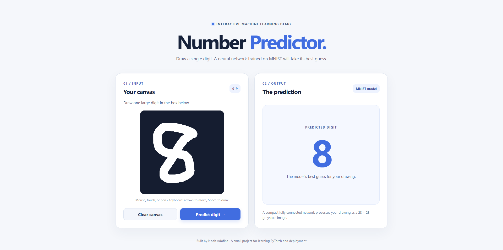

# Number Predictor

An interactive handwritten digit recognition app I built while learning PyTorch and machine learning deployment. Draw a digit from 0 to 9, and a neural network trained on the MNIST dataset will predict what you wrote.

**[Try the Live Demo](https://noahs-number-predictor-mnist-nn.vercel.app/)** · **[View Training Notebook](training/MNIST_NN.ipynb)**

## Demo



Draw a digit using your mouse, touchscreen, or pen, then click **Predict digit** to see the model's prediction.

The interface also supports keyboard drawing: focus the canvas, use the arrow keys to move the cursor, and hold Space while moving to draw.

## How It Works

```text
Handwritten Digit
       ↓
HTML Canvas → PNG Image
       ↓
Flask API (/predict)
       ↓
Image Preprocessing
Grayscale → 28×28 → Normalize
       ↓
PyTorch Neural Network
784 → 128 → 64 → 10
       ↓
Predicted Digit (0–9)
       ↓
Frontend Result Display
```

### Neural Network

The model is a fully connected neural network built with PyTorch and trained on the MNIST handwritten digit dataset.

Its architecture consists of:

- **Input layer:** 784 features (28 × 28 grayscale pixels)
- **Hidden layer 1:** 128 neurons with ReLU activation
- **Hidden layer 2:** 64 neurons with ReLU activation
- **Output layer:** 10 neurons representing digits 0–9

The network uses the highest-scoring output to determine its prediction.

The original training notebook recorded **93.86% test accuracy on MNIST**. This result reflects performance on the MNIST test dataset, not necessarily on arbitrary drawings submitted through the web interface.

The original training implementation and evaluation are available in [`training/MNIST_NN.ipynb`](training/MNIST_NN.ipynb).

### Prediction Pipeline

1. The user draws a digit on an HTML canvas.
2. JavaScript converts the drawing into a PNG and sends it to the Flask API.
3. The backend converts the image to grayscale, resizes it to 28 × 28 pixels, and normalizes the tensor using a mean and standard deviation of 0.5.
4. PyTorch runs inference using the pretrained model.
5. Flask returns the predicted digit as JSON.
6. The frontend displays the prediction.

The application uses the original trained model weights without requiring retraining.

## Tech Stack

| Component | Technologies |
| --- | --- |
| Frontend | HTML, CSS, JavaScript |
| Backend | Python, Flask, Waitress |
| Machine Learning | PyTorch, torchvision |
| Image Processing | Pillow |
| Frontend Hosting | Vercel |
| Backend Hosting | Render |

## Features

- Interactive canvas with mouse, touch, pen, and keyboard support
- Handwritten digit recognition for digits 0–9
- Responsive interface for desktop and mobile
- Immediate prediction feedback
- Loading indicators and backend cold-start messaging
- Request timeout handling and retry functionality
- Protection against outdated prediction results when drawings change
- Input validation and error handling

### Deployment Considerations

The frontend is hosted on Vercel, while the Flask API and PyTorch model run on Render.

Because the backend uses Render's free tier, it may become inactive after periods of inactivity. The first prediction after a quiet period can therefore take longer while the server starts.

To improve the experience, the frontend displays loading feedback immediately, explains potential cold starts after six seconds, and allows up to 75 seconds before timing out.

Failed requests provide an option to retry. The application does not continuously poll the backend or send background requests to keep it awake.

## Project Structure

```text
├── backend/
│   ├── mnist_model.pth
│   ├── requirements.txt
│   └── server.py
├── frontend/
│   ├── index.html
│   ├── script.js
│   └── style.css
├── training/
│   └── MNIST_NN.ipynb
├── tests/
├── docs/
│   └── screenshots/
│       └── number-predictor.png
└── README.md
```

The `training/` directory contains the original neural network training notebook. The `backend/` directory contains the exported model weights used for inference.

## Running Locally

### Requirements

- Python
- Dependencies listed in `backend/requirements.txt`

### 1. Clone the repository

```bash
git clone https://github.com/Noah-Adofina/noahs-number-predictor--MNIST-NN.git
cd noahs-number-predictor--MNIST-NN
```

### 2. Create a virtual environment

```powershell
python -m venv .venv
.\.venv\Scripts\Activate.ps1
```

On macOS or Linux:

```bash
source .venv/bin/activate
```

### 3. Install dependencies

```bash
python -m pip install -r backend/requirements.txt
```

### 4. Start the application

```bash
python backend/server.py
```

Open **http://localhost:8000** in your browser.

The Flask development server serves the frontend locally, and the frontend automatically connects to the local API when accessed through `localhost` or `127.0.0.1`.

The pretrained model is loaded from `backend/mnist_model.pth`, so no additional training is necessary.

### API Endpoints

| Endpoint | Method | Description |
| --- | --- | --- |
| `/health` | GET | Returns the backend health status |
| `/predict` | POST | Accepts an image and returns a digit prediction |

Example requests:

```powershell
curl.exe http://localhost:8000/health
curl.exe -F "file=@digit.png" http://localhost:8000/predict
```

Example prediction response:

```json
{
  "prediction": 7
}
```

Missing or invalid image uploads return HTTP 400.

## What I Learned

This project was an introduction to building and deploying a complete machine learning application, from training a neural network to making its predictions accessible through a web interface.

Through the project, I gained experience with:

- Building and training neural networks using PyTorch
- Preparing image data for model inference
- Connecting a Python machine learning backend to a JavaScript frontend
- Building REST API endpoints with Flask
- Deploying frontend and backend services independently
- Handling real-world challenges such as server cold starts, network failures, and asynchronous requests

It started as a simple experiment with handwritten digit classification and evolved into a small, interactive demonstration of the complete machine learning workflow.